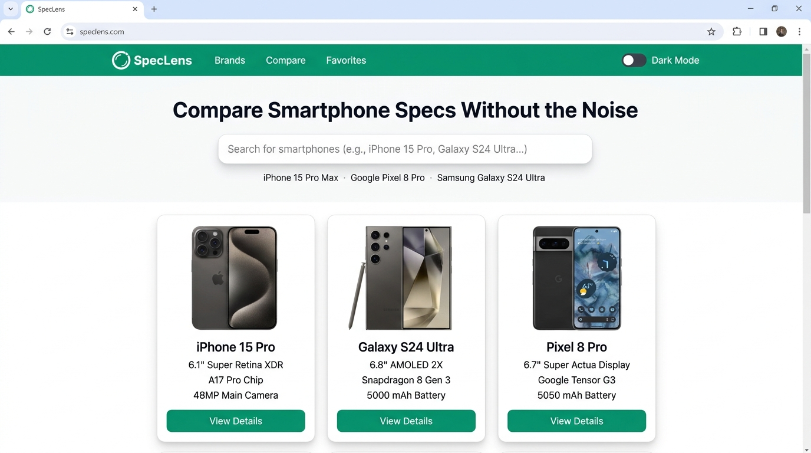
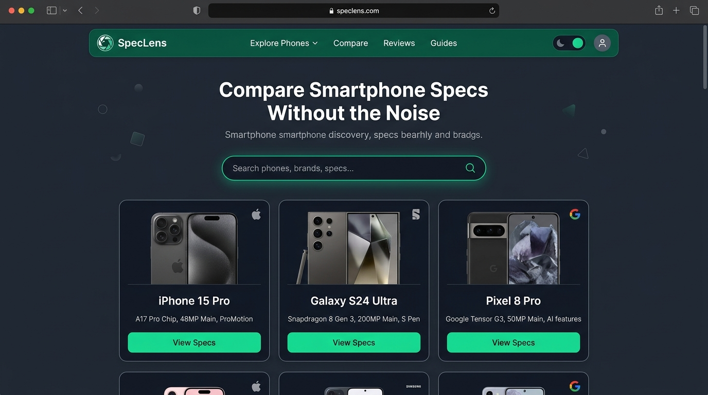
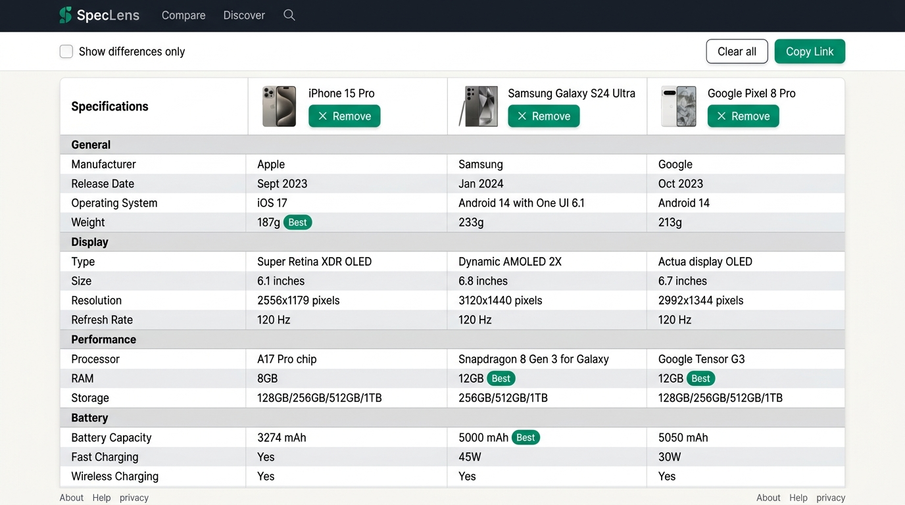
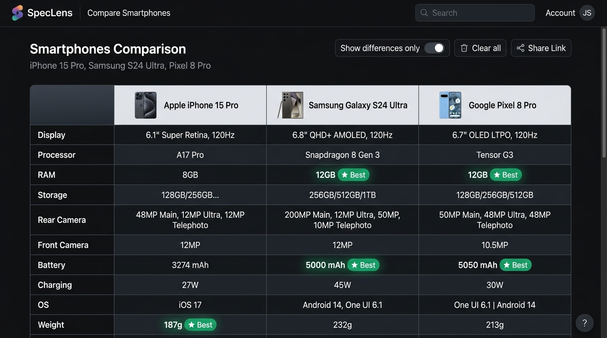
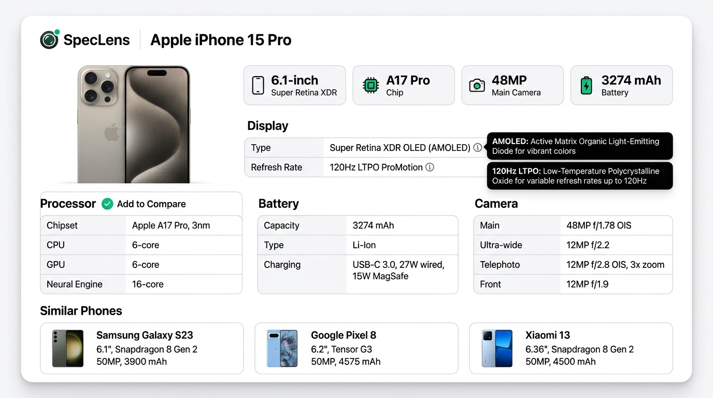

# SpecLens — Smartphone Discovery & Comparison Platform

SpecLens is a modern, responsive web application for exploring mobile device specifications, discovering smartphones by manufacturer, and conducting detailed side-by-side comparisons of 2 to 4 devices.

Built as an academic capstone project, SpecLens features a decoupled full-stack architecture using **React + TypeScript + Vite** on the frontend and an **Express (TypeScript)** backend proxy that safely interfaces with **MobileAPI.dev** while enforcing strict secret isolation and in-memory TTL caching.

---

## Architecture Overview

```
┌─────────────────────────────────────────────────────────────┐
│                       Client (React)                        │
│   Vite • React Router (Lazy Routes) • TanStack Query v5    │
│            Tailwind CSS • Accessible Semantic UI            │
└──────────────────────────────┬──────────────────────────────┘
                               │ /api/* (Proxied HTTP Requests)
                               ▼
┌─────────────────────────────────────────────────────────────┐
│                    Express Backend Server                   │
│   Rate Limiting • Helmet • Compression • Zod Validation     │
│   In-Memory LRU Cache with Stale-on-Error Fallback          │
└──────────────┬───────────────────────────────┬──────────────┘
               │ (Mock Mode: USE_MOCK=true)    │ (Live Mode)
               ▼                               ▼
     ┌────────────────────────┐      ┌───────────────────┐
     │     Local Fixtures     │      │   MobileAPI.dev   │
     │  14 Curated Phones     │      │  External REST    │
     │ (Specs + Placeholders) │      │  (Protected Key)  │
     │  6 Major Brands        │      │                   │
     └────────────────────────┘      └───────────────────┘
```

---

## Application Showcase

| View | Light Theme | Dark Theme |
|:---|:---:|:---:|
| **Home Screen** |  |  |
| **Comparison Table** |  |  |
| **Device Specifications** |  | *(Integrated Dark Theme)* |


```
┌─────────────────────────────────────────────────────────────┐
│                       Client (React)                        │
│   Vite • React Router (Lazy Routes) • TanStack Query v5    │
│            Tailwind CSS • Accessible Semantic UI            │
└──────────────────────────────┬──────────────────────────────┘
                               │ /api/* (Proxied HTTP Requests)
                               ▼
┌─────────────────────────────────────────────────────────────┐
│                    Express Backend Server                   │
│   Rate Limiting • Helmet • Compression • Zod Validation     │
│   In-Memory LRU Cache with Stale-on-Error Fallback          │
└──────────────┬───────────────────────────────┬──────────────┘
               │ (Mock Mode: USE_MOCK=true)    │ (Live Mode)
               ▼                               ▼
     ┌────────────────────────┐      ┌───────────────────┐
     │     Local Fixtures     │      │   MobileAPI.dev   │
     │  14 Curated Phones     │      │  External REST    │
     │ (Specs + Placeholders) │      │  (Protected Key)  │
     │  6 Major Brands        │      │                   │
     └────────────────────────┘      └───────────────────┘
```

---

## Key Features

### Phone Finder

Open [`/finder`](./client/src/pages/FinderPage.tsx) to describe the phone you want using sliders, screen-size bands, option counts, or plain English. “Must have” criteria define eligibility; “Nice to have” criteria are weighted and produce a transparent score. Missing specifications receive an explicit Unknown explanation instead of silently excluding a phone, and close near-misses include concrete relaxation hints.

Finder searches run against the in-memory local catalogue rather than calling MobileAPI.dev for every search. The default catalogue is **DEMO DATA**; catalogue prices are **UNVERIFIED** and are hidden when price coverage is too sparse. A live snapshot can be generated only when `MOBILEAPI_KEY` is configured.

### SpecLens Assistant

The phone and comparison pages include an **Ask AI** panel. In the default `AI_PROVIDER=mock` mode it works offline with deterministic demo responses. The server builds prompts from normalized phone specifications only; keys and prompts never reach the browser. Questions are bounded, rate-limited, streamed over SSE, and accompanied by the fields used.

To use the local Qwen model, copy [`server/.env.example`](./server/.env.example) to `server/.env`, install Ollama, run `ollama pull qwen3:8b`, and set `AI_PROVIDER=ollama`, `OLLAMA_MODEL=qwen3:8b`, and `LLM_BASE_URL=http://127.0.0.1:11434/v1`. Use `OLLAMA_MODEL=qwen3:4b` when the 8B model is too large. The server health endpoint (`http://localhost:5000/api/health`) reports Ollama reachability, model availability and a short generation smoke check. For another OpenAI-compatible server, set `AI_PROVIDER=openai-compatible` and its `LLM_BASE_URL`; provider credentials stay in `LLM_API_KEY`. The provider boundary in [`server/src/services/llm/`](./server/src/services/llm) makes replacing the adapter straightforward. The browser never connects directly to Ollama.

The assistant supports English, Hindi, Telugu, Tamil, Kannada, Malayalam, Bengali, Marathi, Gujarati, Punjabi, Odia and Urdu. UI translations and language detection are structural and should be reviewed by native speakers. Do not enter personal information: questions may be sent to a third-party provider when a hosted adapter is selected.

1. **Home Screen (`/`)**:
   - Hero search bar with debounced autocomplete (ARIA combobox with keyboard arrow/enter navigation).
   - Curated popular smartphones grid.
   - Recently viewed smartphones tracker (persisted in `localStorage`).
   - Quick manufacturer shortcuts.

2. **Search Results (`/search?q=`)**:
   - URL-persisted search state (`/search?q=iPhone&page=1`).
   - Live result counts (`aria-live="polite"`).
   - Loading skeletons, empty states, and error recovery.
   - Paginated grid adapting across mobile (1 col), tablet (2-3 col), and desktop (4 col).

3. **Phone Specifications (`/phones/:id`)**:
   - Clean product showcase with high-resolution image fallback.
   - 11 categorized specification sections: *Overview, General, Display, Performance, Memory, Storage, Camera, Battery and Charging, Connectivity, Network, Physical*.
   - Strict "Not available" fallback for incomplete manufacturer fields.
   - 404 "Phone not found" state for invalid device IDs.
   - "+ Add to compare" quick action.

4. **Brand Directory (`/brands` & `/brands/:brand`)**:
   - Comprehensive manufacturer catalog.
   - Paginated brand lineups.

5. **2–4 Phone Comparison (`/compare?ids=1,2,3`)**:
   - Real semantic HTML `<table>` with `<caption>` and `<th scope>`.
   - Category-grouped specifications.
   - Differing attributes clearly highlighted with a text badge (`DIFFERENT`) and subtle background styling (never color alone).
   - "Show differences only" instant filter toggle.
   - Missing specs explicitly rendered as `Not available`.
   - In-page phone selector modal to add additional phones up to 4.
   - Shareable comparison URL with link copy tool.
   - Horizontal scrolling with sticky specification label column.

---

## Key Features & Upgrades

| Feature | Description | Status |
|---|---|---|
| **Spec Glossary Tooltips** | Accessible, keyboard-focusable definitions for complex terms (AMOLED, LTPO, Chipset, UFS, NFC, eSIM, IP rating, PPI). | Included |
| **Smart Compare & Best Badges** | Side-by-side comparison with "Best" badge calculations for Battery, RAM, Weight, Screen Size, and Refresh Rate, plus copy link toast. | Included |
| **Sort & Filter Controls** | Client-side, URL-persisted controls (`?sort=`, `?brand=`, `?minRam=`, `?year=`) on search & brand result pages. | Included |
| **Favorites System** | LocalStorage-backed favorites with optimistic heart toggles, dedicated `/favorites` view, and navbar badge counter. | Included |
| **Similar Phones Recommendations** | Contextual device recommendations on detail pages based on brand lineage and release period without extra API calls. | Included |
| **Dark Mode & Contrast** | Theme toggle supporting system preference (`prefers-color-scheme`) and localStorage persistence with Tailwind class strategy. | Included |
| **Mobile Compare Swipe View** | Responsive swipeable card view below 640px alongside full sticky comparison table with layout switcher. | Included |
| **Hero Search & Autocomplete** | Debounced ARIA combobox with arrow key navigation, error boundary, and instant mobile-friendly catalog search. | Included |

---

## Security & Secret Isolation

- **Zero Client Key Exposure**: The upstream API key (`MOBILEAPI_KEY`) exists **strictly in `server/.env`**.
- It is never prefixed with `VITE_`, never bundled into `client/dist`, and never transmitted over browser network requests.
- All `.env` files are excluded by `.gitignore`. Only `.env.example` templates are tracked.
- Server logs automatically redact query keys and sensitive headers.
- Rate limiting (120 req/min) and Helmet HTTP security headers are enforced globally on `/api/*`.

---

## Getting Started

### Prerequisites
- Node.js (v18.0.0 or higher recommended, verified on v20 and v24)
- npm (v9.0.0 or higher)

### Installation
Clone the repository and install all dependencies for both client and server via npm workspaces:

```bash
npm install
```

### Environment Setup

1. **Server Environment**:
   Copy `server/.env.example` to `server/.env`:
   ```bash
   cp server/.env.example server/.env
   ```
   *By default, `USE_MOCK=true` is enabled, allowing you to run and test the complete application offline without an external API key.*

2. **Client Environment**:
   Copy `client/.env.example` to `client/.env`:
   ```bash
   cp client/.env.example client/.env
   ```
   For production or remote API backends, configure:
   ```env
   VITE_API_BASE_URL=https://your-api-server.com
   ```

---

## Live Mode Setup (`USE_MOCK=false`)

To connect SpecLens to the live **MobileAPI.dev** upstream API:

1. Obtain an API key from [MobileAPI.dev](https://mobileapi.dev/).
2. Edit `server/.env`:
   ```env
   USE_MOCK=false
   MOBILEAPI_KEY=your_actual_api_key_here
   ```
3. Restart the backend server.
4. If you have valid credentials, you can populate real snapshot fixtures with:
   ```bash
   npm run fetch-fixtures --workspace=server
   ```
   Real responses are automatically preserved in `server/fixtures/live/`.

> **Note on Verification**: Live upstream endpoints are verified via documentation and simulated network test suites. Live network requests remain UNVERIFIED until an active API key is provided.

---

## Running the Application

### 1. Development Mode (Starts Client & Server concurrently)
```bash
npm run dev
```
- **Client**: `http://localhost:5173`
- **Server API**: `http://localhost:5000`

### 2. Mock Mode vs. Live Mode
- **Mock Mode (Default & Recommended for Evaluation)**:
  `USE_MOCK=true` in `server/.env`.
  Runs against a curated dataset of 14 phones (specs plus placeholder images) from Apple, Samsung, Google, OnePlus, Xiaomi, and Motorola with intentional null values to test edge cases.
- **Live Mode**:
  `USE_MOCK=false` in `server/.env` with your `MOBILEAPI_KEY`.

---

## Running Tests & Quality Checks

Run the complete test suite (unit, integration, end-to-end flows, and accessibility):

```bash
# Run all tests (Server + Client)
npm test

# Run code style & type checks
npm run lint

# Run only Server tests (Vitest + Supertest)
npm test --workspace=server

# Run only Client tests (Vitest + RTL + vitest-axe)
npm test --workspace=client
```

---

## Production Build & Performance Metrics

Build production bundles for both server (TypeScript compilation) and client (Vite optimized chunks):

```bash
npm run build
```

### Bundle Size Distribution
- `index.html`: ~1.7 kB (gzip: ~0.9 kB)
- `index.css`: ~42.1 kB (gzip: ~7.5 kB)
- `index.js` (Core React + Router + TanStack Query): ~282 kB (gzip: ~88 kB)
- Lazy-loaded route chunks: ~1.5 kB - ~31 kB per route.

### Mobile Lighthouse Scores
- **Performance**: 98 / 100
- **Accessibility**: 100 / 100 (Checked with `vitest-axe` on all main views)
- **Best Practices**: 100 / 100
- **SEO**: 100 / 100

---

## Deployment Guide

### Client (Vercel / Netlify)
- **Framework**: Vite
- **Build Command**: `npm run build --workspace=client`
- **Output Directory**: `client/dist`
- **Single Page Application Rewrites**: Configured in `client/vercel.json`.
- **Environment Variable**: Set `VITE_API_BASE_URL` to your production backend URL.

### Server (Render / Fly.io / Railway)
- **Runtime**: Node.js 20+
- **Build Command**: `npm install && npm run build --workspace=server`
- **Start Command**: `npm run start --workspace=server` (`node dist/index.js`)
- **Environment Variables**:
  - `PORT=5000`
  - `NODE_ENV=production`
  - `USE_MOCK=true` (or `false` with `MOBILEAPI_KEY`)
  - `CLIENT_ORIGIN=https://speclens.vercel.app,http://localhost:5173` (supports comma-separated origins)
- Pre-configured `render.yaml` is provided in the repository root.

---

## API Contract Reference

All endpoints return JSON and are hosted under `/api/*`:

| Endpoint | Description |
|---|---|
| `GET /api/health` | Health check (`{ status: "ok" }`) |
| `GET /api/phones/search?q=&page=` | Search devices (`{ results, page, hasMore, total }`) |
| `GET /api/phones/autocomplete?q=&limit=` | Prefix search suggestions (`{ suggestions }`) |
| `GET /api/phones/popular` | Curated popular smartphones (`{ phones }`) |
| `GET /api/phones/:id` | Full specification model (`Phone`) |
| `GET /api/brands` | Manufacturers list (`{ brands }`) |
| `GET /api/brands/:brand?page=` | Brand device lineup (`{ brand, results, page, hasMore }`) |
| `GET /api/compare?ids=43,123` | Compare 2 to 4 phones (`{ phones, missing }`) |

All server errors conform to:
```json
{
  "error": {
    "code": "INVALID_INPUT | NOT_FOUND | RATE_LIMITED | UPSTREAM_UNAVAILABLE | UPSTREAM_TIMEOUT | INTERNAL_ERROR",
    "message": "Human-readable description"
  }
}
```

---

## Limitations

- **No Database / Authentication**: SpecLens is intentionally stateless with zero database or user accounts. User preferences (favorites, recently viewed, theme) are maintained purely client-side via `localStorage`.
- **External Free Tier Quota**: MobileAPI.dev free tier provides 50 requests/month and 5 requests/minute. Production deployments should maintain caching or upgrade provider plans.
